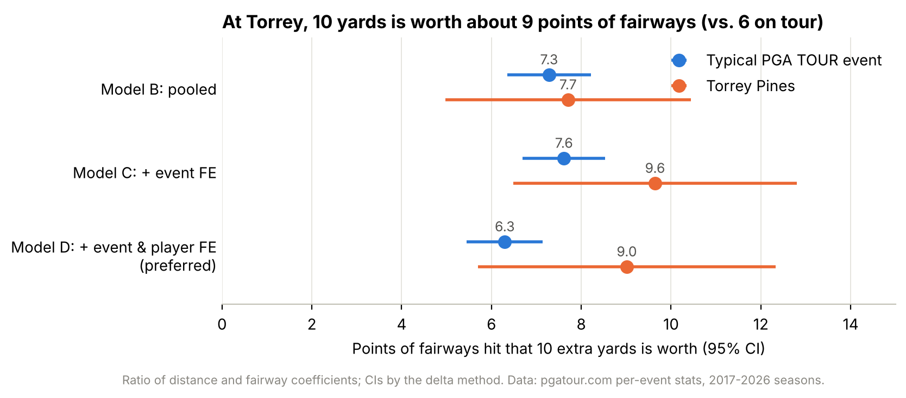
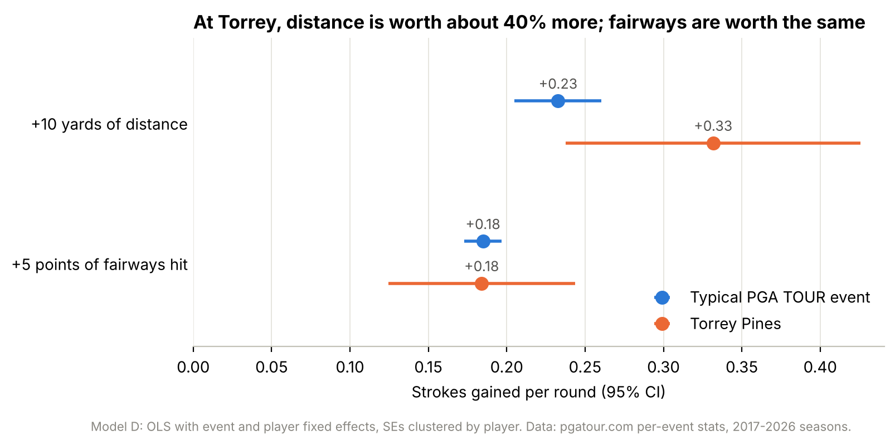
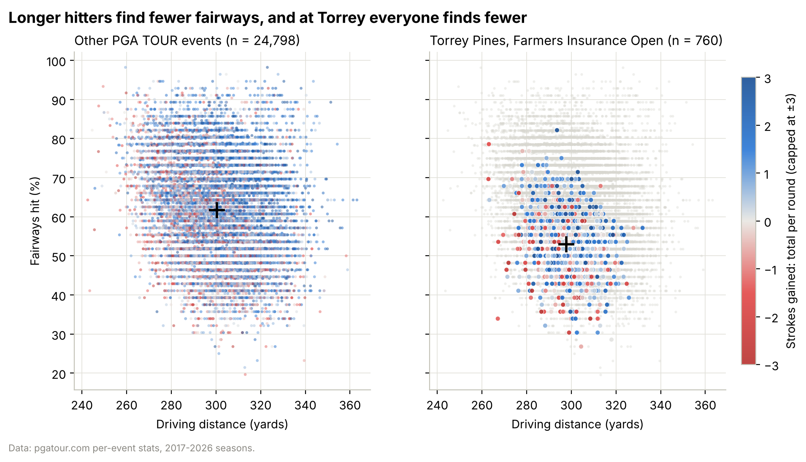

# Distance vs. Accuracy at Torrey Pines

**Is it better to hit it farther and miss more fairways, or shorter and find more fairways, at Torrey Pines, home of the PGA TOUR's Farmers Insurance Open? And how does that trade-off compare with a typical PGA TOUR event?**

**Short answer:** at Torrey, distance is the better bet. After controlling for the field each week and for each player's skill, **10 extra yards is worth about as much as 9 more percentage points of fairways hit at Torrey, against about 6 points at a typical tour event.**



---

## Findings

1. **Torrey is a fairway-killer, not a distance-killer.** Players hit 53% of fairways at Torrey vs. 62% at other events, while driving distance is nearly identical (298 vs. 300 yards).
2. **At Torrey, distance pays more and fairways pay the same.** Each extra yard is worth about 40% more strokes gained at Torrey than at a typical event (+0.33 vs. +0.23 strokes per round for 10 yards; interaction p ≈ 0.04). A percentage point of fairways is worth the same in both places (+0.037 strokes per round). With SG: Off-the-Tee as the outcome, the Torrey distance premium is highly significant (p < 0.001), and fairways are actually worth *less* there.
3. **Controlling for player skill matters.** Better players tend to be both longer and straighter. Comparing each player with his own usual performance (player fixed effects) shrinks the distance effect by about a quarter, but the extra value of distance at Torrey survives.

| | Typical PGA TOUR event | Torrey Pines |
|---|---|---|
| Strokes gained per round from +10 yards | +0.23 | +0.33 |
| Strokes gained per round from +5 pts fairways | +0.18 | +0.18 |
| **10 yards is worth this many pts of fairways** | **6.3** (95% CI 5.5–7.1) | **9.0** (95% CI 5.7–12.3) |



## Data

- **Source:** PGA TOUR per-event ("Tournament Only") statistics from pgatour.com's data feed, 2017–2026 seasons. Driving Distance (stat 101), Driving Accuracy % (102), SG: Total (02675), SG: Tee-to-Green (02674), SG: Off-the-Tee (02567).
- **Unit of observation:** one player at one event. The full file has 29,635 rows from 424 events and 1,037 players. The 25,558 rows with strokes-gained data (366 events, 940 players) are used in the models.
- **Torrey:** 760 player-events from 10 Farmers Insurance Opens (North + South courses combined, flagged by `is_torrey`). Event-level data can't separate the two courses.
- **Comparison group:** every other individual stroke-play PGA TOUR event. Team and match-play events are excluded. Events without ShotLink tracking (the Masters, The Open, opposite-field events) have no strokes gained and drop out of the models.

| Column | Meaning |
|---|---|
| `player`, `player_id` | Player name and PGA TOUR ID |
| `year` | Season (labeled by the year it ends) |
| `event`, `tournament_id` | Tournament name and ID |
| `is_torrey` | 1 = Farmers Insurance Open at Torrey Pines |
| `distance` | Driving distance, yards (2 measured drives per round) |
| `fairway_pct` | Driving accuracy, % of fairways hit |
| `sg_total`, `sg_t2g`, `sg_ott` | Strokes gained per round: total, tee-to-green, off-the-tee |
| `sg_rounds` | Rounds with strokes-gained measurement |



## Method

OLS regression with [statsmodels](https://www.statsmodels.org/), built up in four steps:

| Model | Specification | Purpose |
|---|---|---|
| A | `sg_total ~ distance + fairway_pct`, fit separately for Torrey and other events | Simplest version |
| B | pooled, with `distance × torrey` and `fairway_pct × torrey` interactions | Formal test of whether Torrey differs |
| C | B + event fixed effects | Compare each player with that week's field (removes course, weather and field-strength effects) |
| **D** | C + player fixed effects | Compare each player with himself (removes confounding from overall skill). **Preferred.** |

Standard errors are clustered by player. The trade-off "10 yards = X points of fairways" is $X = 10\,\beta_{distance}/\beta_{fairway}$, with Torrey slopes equal to the base slope plus the interaction. Its 95% confidence interval comes from the delta method. As robustness checks, the same model is also fit with SG: Tee-to-Green and SG: Off-the-Tee as the outcome.

## Limitations

- **Small Torrey sample.** 10 tournaments and 760 player-events give wide intervals. The Torrey trade-off interval (≈6–12) overlaps the tour's (≈5.5–7), so the evidence is moderate, not overwhelming.
- **Mostly cut-makers.** The per-event tables mostly include players who made the cut, so the worst weeks are missing. That likely shrinks all the slopes toward zero.
- **Course mix at Torrey.** Torrey strokes gained comes only from the South Course rounds (3 of 4), consistent with ShotLink covering the South Course only. Distance and accuracy may include the North Course round.
- **Association, not causation.** A player's distance and accuracy in a given week partly reflect how well he's swinging, so the results don't prove a deliberate strategy change would pay off.
- **Data terms.** pgatour.com's Terms of Use (§7(C)) prohibit automated downloading of its statistics, and §7(D) limits use to personal, non-commercial purposes. The data was collected for personal study and is **not included in this repository**.

## Repository layout

| Path | Contents |
|---|---|
| `notebooks/torrey_pines_analysis.ipynb` | **The clean, end-to-end analysis** (start here) |
| `notebooks/01_explore.ipynb`, `02_model.ipynb` | Step-by-step working notebooks |
| `scripts/download_pga_stats.py` | Downloads per-event stats into `data/raw/` |
| `scripts/build_tidy_csv.py` | Builds `data/clean/pga_event_stats.csv` from the raw files |
| `figures/` | The three charts |
| `notes/` | Setup walkthrough and data-source research |

## How to run

```bash
python3 -m venv .venv
source .venv/bin/activate              # Windows: .venv\Scripts\activate
python -m pip install -r requirements.txt
python scripts/download_pga_stats.py   # ~2,000 requests at 1/second; resumable
python scripts/build_tidy_csv.py
jupyter notebook notebooks/torrey_pines_analysis.ipynb
```
